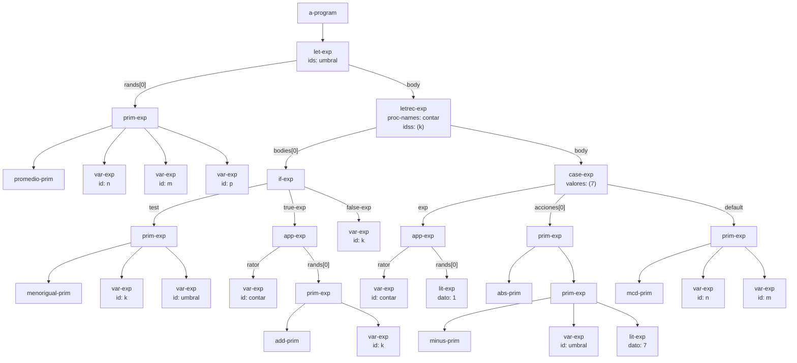
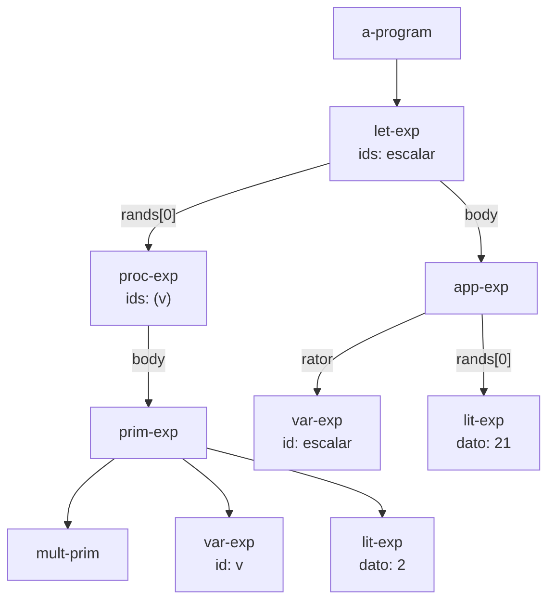
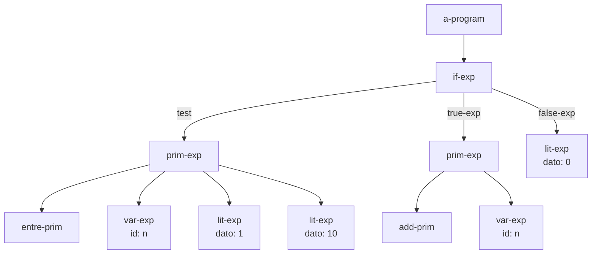
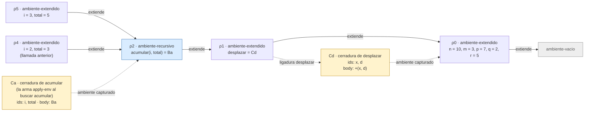

# Informe de AST — Taller 2: El intérprete de Cauca

**Curso:** Fundamentos de Interpretación y Compilación de Lenguajes
de Programación — Universidad del Valle, Sede Tuluá.

**Integrantes del grupo:**

| Nombre | Código | Correo institucional |
|--------|--------|----------------------|
| Josue David Cocoma Tascon | 2477087 | josue.cocoma@correounivalle.edu.co |
| Juan Diego Montaño Vergara | 2477334 | juan.diego.montano@correounivalle.edu.co |

---

## 1. Gramática considerada

Gramática completa de Cauca (partes 1 a 4). Debajo de cada producción va el
nombre del constructor que SLLGEN genera con `sllgen:make-define-datatypes`.

```bnf
<programa>  ::= <expresion>
                a-program(exp)

<expresion> ::= <numero>
                lit-exp(dato)
            ::= <identificador>
                var-exp(id)
            ::= "true"
                true-exp()
            ::= "false"
                false-exp()
            ::= <primitiva> "(" {<expresion>}*(,) ")"
                prim-exp(prim, rands)
            ::= "if" <expresion> "then" <expresion> "else" <expresion> "end"
                if-exp(test, true-exp, false-exp)
            ::= "let" {<identificador> "=" <expresion>}* "in" <expresion> "end"
                let-exp(ids, rands, body)
            ::= "proc" "(" {<identificador>}*(,) ")" <expresion> "end"
                proc-exp(ids, body)
            ::= "apply" <expresion> "(" {<expresion>}*(,) ")"
                app-exp(rator, rands)
            ::= "letrec" {<identificador> "(" {<identificador>}*(,) ")" "=" <expresion>}*
                "in" <expresion> "end"
                letrec-exp(proc-names, idss, bodies, body)
            ::= "case" <expresion> {"of" <numero> "=>" <expresion>}+
                "otherwise" "=>" <expresion> "end"
                case-exp(exp, valores, acciones, default)

<primitiva> ::= "+"  sum-prim()          ::= "-"  minus-prim()
            ::= "*"  mult-prim()         ::= "/"  div-prim()
            ::= "add1" add-prim()        ::= "sub1" sub-prim()
            ::= ">"  mayor-prim()        ::= ">=" mayorigual-prim()
            ::= "<"  menor-prim()        ::= "<=" menorigual-prim()
            ::= "==" igual-prim()        ::= "not" not-prim()
            ::= "and" and-prim()         ::= "or" or-prim()
            ::= "abs" abs-prim()         ::= "mcd" mcd-prim()
            ::= "mcm" mcm-prim()         ::= "promedio" promedio-prim()
            ::= "xor" xor-prim()         ::= "implica" implica-prim()
            ::= "entre" entre-prim()
```

En los diagramas, cada nodo lleva el nombre del constructor. Los hijos que son
listas (`rands`, `bodies`, `acciones`) se conectan con una arista rotulada con
el nombre del campo y la posición dentro de la lista. Los datos que no son
expresiones (los `ids`, los literales de `valores`) se escriben dentro de la
etiqueta del nodo que los contiene. Cada `prim-exp` tiene como primer hijo la
primitiva (`sum-prim`, `abs-prim`, ...) y después los argumentos.

---

## 2. Ejemplos de AST

### Ejemplo 1 — Programa de la Parte 5.1 (`let` + `letrec` + `case`)

**Expresión concreta:**

```scheme
let umbral = promedio(n, m, p)
in
  letrec
    contar (k) = if <=(k, umbral)
                 then apply contar (add1(k))
                 else k
                 end
  in
    case apply contar (1)
      of 7 => abs(-(umbral, 7))
      otherwise => mcd(n, m)
    end
  end
end
```

**AST:**



**Explicación:** el programa es un `a-program` cuya expresión es un `let-exp`
con una sola ligadura (`umbral`), cuyo valor es un `prim-exp` con
`promedio-prim` y tres `var-exp`. El cuerpo del `let` es un `letrec-exp` que
declara un solo procedimiento, `contar`, de parámetro `k`. El cuerpo de
`contar` es un `if-exp`: su condición es un `prim-exp` con `menorigual-prim`,
la rama verdadera es una aplicación recursiva (`app-exp` con rator
`var-exp contar` y un argumento `add1(k)`) y la falsa es `var-exp k`. El
cuerpo del `letrec` es un `case-exp`: su expresión de control es otra
`app-exp` (`contar` aplicado a `lit-exp 1`), tiene una sola rama
(`7 => abs(-(umbral, 7))`, con un `prim-exp` anidado dentro de otro) y la rama
`otherwise` es `mcd(n, m)`. Los literales de las ramas de un `case-exp` (aquí
`7`) no son nodos `lit-exp`: son datos del propio constructor.

---

### Ejemplo 2 — Procedimiento y aplicación

**Expresión concreta:**

```scheme
let escalar = proc (v) *(v, 2) end
in apply escalar (21) end
```

**AST:**



**Explicación:** el `proc-exp` es la expresión que el `let-exp` evalúa para
ligar `escalar`; al evaluarlo no se ejecuta su cuerpo, solo se construye una
clausura. El `app-exp` del cuerpo del `let` tiene como operador un `var-exp`
(no puede ser otra aplicación escrita en el mismo lugar, ver la gramática) y
un único argumento.

---

### Ejemplo 3 — Condicional con primitivas nuevas

**Expresión concreta:**

```scheme
if entre(n, 1, 10) then add1(n) else 0 end
```

**AST:**



**Explicación:** `entre` es ternaria, así que su `prim-exp` tiene tres
argumentos; `add1` es unaria y tiene uno. El `if-exp` guarda sus tres
subexpresiones en los campos `test`, `true-exp` y `false-exp`.

---

## 3. Traza de evaluación

Se usa la notación $\textit{value-of}(e, \rho)$ de EOPL, con las siguientes
convenciones:

- $\rho \oplus [x_1 = v_1, \ldots]$ es el ambiente que extiende a $\rho$ con las
  ligaduras nuevas (en el código, `ambiente-extendido`). Se escribe
  $[x_1 = v_1, \ldots] \oplus \rho$ cuando importa que las ligaduras nuevas son
  las más recientes.
- $\rho_0 = [\,n = 10,\ m = 3,\ p = 7,\ q = 2,\ r = 5\,]$ es el ambiente inicial,
  que extiende al ambiente vacío $\varnothing$.
- $\langle \mathit{ids},\ \mathit{cuerpo},\ \sigma \rangle$ es una clausura
  (`cerradura`) con su ambiente de definición $\sigma$.
- $\mathrm{rec}\{f(\mathit{ids}) = \mathit{cuerpo}\} \oplus \sigma$ es un
  `ambiente-recursivo`. Guarda los nombres, los parámetros y los cuerpos sin
  evaluar; no contiene clausuras.

**Expresión a evaluar:**

```scheme
let desplazar = proc (x, d) +(x, d) end
in
  letrec
    acumular (i, total) = if >(i, m)
                          then total
                          else apply acumular
                                 (add1(i), apply desplazar (total, i))
                          end
  in
    apply acumular (1, q)
  end
end
```

Se abrevia $B_a$ al cuerpo de `acumular`:

$$
B_a \;=\; \texttt{if >(i, m) then total else apply acumular (add1(i), apply desplazar (total, i)) end}
$$

**Ambiente inicial:** $\rho_0 = [\,n = 10,\ m = 3,\ p = 7,\ q = 2,\ r = 5\,]$.

**Pasos de la traza:**

**Paso 1.** $\textit{value-of}(\texttt{let desplazar = proc (x, d) +(x, d) end in } \ldots \texttt{ end},\ \rho_0)$

- 1.1. Se evalúa el rand: $\textit{value-of}(\texttt{proc (x, d) +(x, d) end},\ \rho_0)$.
  `proc-exp` no evalúa el cuerpo: construye la clausura
  $C_d = \langle (x, d),\ \texttt{+(x, d)},\ \rho_0 \rangle \;\to\; C_d$.
- 1.2. Se extiende el ambiente actual:
  $\rho_1 = [\,\texttt{desplazar} = C_d\,] \oplus \rho_0$.

**Paso 2.** $\textit{value-of}(\texttt{letrec acumular (i, total) = } B_a \texttt{ in apply acumular (1, q) end},\ \rho_1)$

- 2.1. `letrec-exp` no construye ninguna clausura. Crea el ambiente recursivo
  $\rho_2 = \mathrm{rec}\{\texttt{acumular}\,(i, total) = B_a\} \oplus \rho_1$
  y evalúa el cuerpo en él.

**Paso 3.** $\textit{value-of}(\texttt{apply acumular (1, q)},\ \rho_2)$

- 3.1. Operador: $\textit{value-of}(\texttt{acumular},\ \rho_2)$. `apply-env`
  encuentra `acumular` en los nombres del ambiente recursivo y construye
  $C_a = \langle (i, total),\ B_a,\ \rho_2 \rangle$, con el propio $\rho_2$ como
  ambiente. $\;\to\; C_a$.
- 3.2. $\textit{value-of}(\texttt{1}, \rho_2) \to 1$.
- 3.3. $\textit{value-of}(\texttt{q}, \rho_2)$: `q` no está en $\rho_2$ (solo
  `acumular`), ni en $\rho_1$ (solo `desplazar`); sí en $\rho_0$. $\;\to\; 2$.
- 3.4. $\textit{apply-procedure}(C_a,\ (1, 2))$: 2 parámetros, 2 argumentos.
  El cuerpo se evalúa en el ambiente de la clausura extendido con los
  parámetros, no en el de la llamada:
  $\rho_3 = [\,i = 1,\ total = 2\,] \oplus \rho_2$.

**Paso 4.** $\textit{value-of}(B_a,\ \rho_3)$, con $\rho_3 = [\,i = 1,\ total = 2\,] \oplus \rho_2$

- 4.1. Condición: $\textit{value-of}(\texttt{>(i, m)},\ \rho_3)$. `i` $\to 1$ en
  $\rho_3$; `m` se busca en $\rho_3$, $\rho_2$, $\rho_1$ y se encuentra en
  $\rho_0$ $\to 3$. $\;\texttt{>}(1, 3) \to \texttt{\#f}$. Es booleano, se toma la rama `else`.
- 4.2. $\textit{value-of}(\texttt{apply acumular (add1(i), apply desplazar (total, i))},\ \rho_3)$:
  - operador: `acumular` $\to C_a$ (clausura nueva, otra vez con ambiente $\rho_2$);
  - 1.er argumento: $\textit{value-of}(\texttt{add1(i)}, \rho_3) \to 2$;
  - 2.º argumento: $\textit{value-of}(\texttt{apply desplazar (total, i)}, \rho_3)$:
    `desplazar` no es `i` ni `total`, ni está en el ambiente recursivo (que solo
    declara `acumular`); `apply-env` lo encuentra en $\rho_1$ $\to C_d$.
    Argumentos $(2, 1)$. $\textit{apply-procedure}(C_d, (2, 1))$ evalúa
    $\textit{value-of}(\texttt{+(x, d)},\ [\,x = 2,\ d = 1\,] \oplus \rho_0) \to 3$.
  - $\textit{apply-procedure}(C_a, (2, 3))$:
    $\rho_4 = [\,i = 2,\ total = 3\,] \oplus \rho_2$.

**Paso 5.** $\textit{value-of}(B_a,\ \rho_4)$

- 5.1. $\texttt{>}(2, 3) \to \texttt{\#f}$, rama `else`.
- 5.2. Argumentos: $\texttt{add1(i)} \to 3$;
  $\textit{apply-procedure}(C_d, (3, 2))$ evalúa
  $\textit{value-of}(\texttt{+(x, d)},\ [\,x = 3,\ d = 2\,] \oplus \rho_0) \to 5$.
- 5.3. $\textit{apply-procedure}(C_a, (3, 5))$:
  $\rho_5 = [\,i = 3,\ total = 5\,] \oplus \rho_2$.

**Paso 6.** $\textit{value-of}(B_a,\ \rho_5)$

- 6.1. $\texttt{>}(3, 3) \to \texttt{\#f}$, rama `else`.
- 6.2. Argumentos: $\texttt{add1(i)} \to 4$;
  $\textit{apply-procedure}(C_d, (5, 3))$ evalúa
  $\textit{value-of}(\texttt{+(x, d)},\ [\,x = 5,\ d = 3\,] \oplus \rho_0) \to 8$.
- 6.3. $\textit{apply-procedure}(C_a, (4, 8))$:
  $\rho_6 = [\,i = 4,\ total = 8\,] \oplus \rho_2$.

**Paso 7.** $\textit{value-of}(B_a,\ \rho_6)$

- 7.1. $\texttt{>}(4, 3) \to \texttt{\#t}$, rama `then`.
- 7.2. $\textit{value-of}(\texttt{total},\ \rho_6) \to 8$.

**Resultado final:**

$$
\textit{value-of}(\texttt{let desplazar = } \ldots,\ \rho_0) \;=\; 8
$$

Resumen de las activaciones de `acumular`:

| Activación | Ambiente | `i` | `total` | `>(i, m)` | Siguiente `total` |
|:---:|:---|:---:|:---:|:---:|:---:|
| 1.ª (desde el cuerpo del `letrec`) | $\rho_3$ | 1 | 2 | `#f` | $2 + 1 = 3$ |
| 2.ª (1.ª llamada recursiva) | $\rho_4$ | 2 | 3 | `#f` | $3 + 2 = 5$ |
| 3.ª (2.ª llamada recursiva) | $\rho_5$ | 3 | 5 | `#f` | $5 + 3 = 8$ |
| 4.ª (3.ª llamada recursiva) | $\rho_6$ | 4 | 8 | `#t` | devuelve 8 |

**Diagrama de la cadena de ambientes** en el momento de la segunda llamada
recursiva a `acumular`, es decir, cuando se evalúa $B_a$ en
$\rho_5 = [\,i = 3,\ total = 5\,] \oplus \rho_2$. Las flechas continuas van del
ambiente que extiende hacia el ambiente extendido; las punteadas muestran qué
ambiente captura cada clausura. $\rho_4$ (la llamada anterior, ya terminada de
armar) aparece al lado para mostrar que las activaciones sucesivas no se
encadenan entre sí: todas extienden al mismo ambiente recursivo $\rho_2$.



**Lectura del diagrama.** La cadena que ve el cuerpo $B_a$ es
$\rho_5 \to \rho_2 \to \rho_1 \to \rho_0 \to \varnothing$. Por eso `i` y
`total` se resuelven en $\rho_5$, `acumular` en $\rho_2$ (donde `apply-env`
arma $C_a$ con $\rho_2$ como ambiente), `desplazar` en $\rho_1$ y `m` en
$\rho_0$. La clausura $C_d$ capturó $\rho_0$: cuando se aplica, su cuerpo
`+(x, d)` se evalúa en $[\,x = \ldots,\ d = \ldots\,] \oplus \rho_0$ y no ve
`i`, `total` ni `acumular`, que pertenecen al ambiente de la llamada.

---

## 4. Estado del almacén en una transacción

**No aplica.** Cauca no tiene almacén, asignación ni bloques transaccionales:
las ligaduras son inmutables y el único estado es la cadena de ambientes de la
sección anterior. El enunciado de este taller no pide este ejercicio.

---

## 5. Referencias

- Friedman, D. P., & Wand, M. *Essentials of Programming Languages*,
  3.ª ed., MIT Press, 2008. Secciones 2.2 y 2.3 (sintaxis abstracta y
  ambientes), 3.2 (el lenguaje LET), 3.3 (procedimientos y clausuras,
  Figura 3.7) y 3.4 (procedimientos recursivos, Figura 3.9).
- Mermaid, *Flowcharts syntax*: https://mermaid.js.org/syntax/flowchart.html
- GitHub Docs, *Creating diagrams*:
  https://docs.github.com/en/get-started/writing-on-github/working-with-advanced-formatting/creating-diagrams
