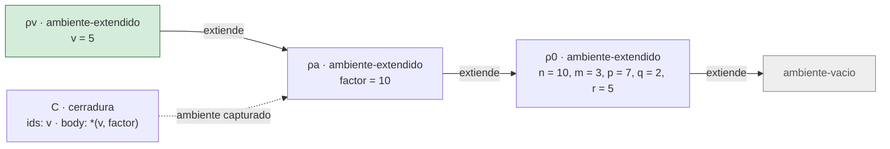
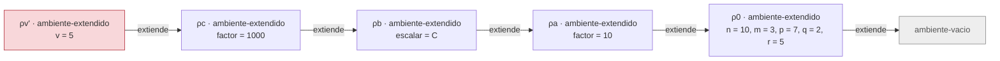

# Informe de corrección — Taller 2: El intérprete de Cauca

**Curso:** Fundamentos de Interpretación y Compilación de Lenguajes
de Programación — Universidad del Valle, Sede Tuluá.

**Integrantes del grupo:**

| Nombre | Código | Correo institucional |
|--------|--------|----------------------|
| Josue David Cocoma Tascon | 2477087 | josue.cocoma@correounivalle.edu.co |
| Juan Diego Montaño Vergara | 2477334 | juan.diego.montano@correounivalle.edu.co |

---

## 1. Marco formal

### 1.1 Corrección de programas recursivos

Sea $f : A \to B$ una función y $A$ un conjunto definido
recursivamente. Sea $P_f$ un programa recursivo en Racket que
pretende calcular $f$. Decimos que $P_f$ es correcto con respecto a
su especificación si se cumple:

$$
\forall a \in A \,:\, P_f(a) = f(a)
$$

La estrategia de demostración es la **inducción estructural**
sobre $A$:

- **Caso base:** para cada valor básico $a_0 \in A$ se verifica
  $P_f(a_0) = f(a_0)$.
- **Caso inductivo:** asumiendo la **hipótesis de inducción**
  $P_f(a') = f(a')$ para las subestructuras $a'$ que forman $a$, se
  demuestra $P_f(a) = f(a)$.

### 1.2 Corrección de programas iterativos

Para un programa iterativo se formalizan:

- Un estado $s$ con componentes relevantes.
- Un estado inicial $s_0$.
- Un estado final reconocido por un predicado $\text{es-final?}(s)$.
- Una **invariante** $\text{Inv}(s)$ que se mantiene entre pasos.
- Una transformación $\text{transformar}(s)$.

La corrección se argumenta demostrando:

1. $\text{Inv}(s_0)$ se cumple al inicio.
2. $\text{Inv}(s) \,\land\, \lnot\text{es-final?}(s)\Rightarrow
   \text{Inv}(\text{transformar}(s))$.
3. $\text{Inv}(s) \,\land\, \text{es-final?}(s)\Rightarrow
   \text{respuesta}(s) = f(\text{entrada})$.
4. El proceso termina (argumentar una función de cota estrictamente
   decreciente sobre $\mathbb{N}$).

### 1.3 Notación y lema de búsqueda (usados en las secciones 2 y 3)

**Notación.** $\textit{value-of}(e, \rho)$ es el valor de la expresión $e$ en el
ambiente $\rho$ (en el código, `evaluar-expresion`). El ambiente es el tipo de
dato

$$
\rho \;::=\; \varnothing \;\mid\; [\,x_1 = v_1, \ldots, x_n = v_n\,] \oplus \sigma \;\mid\;
\mathrm{rec}\{f_1(\vec{x}_1) = b_1, \ldots, f_n(\vec{x}_n) = b_n\} \oplus \sigma
$$

que corresponde a las variantes `ambiente-vacio`, `ambiente-extendido` y
`ambiente-recursivo`. Una clausura es $\langle \vec{x}, b, \sigma \rangle$
(`cerradura`). Se escribe $\mathrm{err}$ cuando la evaluación levanta
`eopl:error`.

Las funciones de apoyo son: $\textit{pos}(x, L)$, el índice de la primera
aparición de $x$ en la lista $L$, o $\bot$ si no aparece (`posicion-en`); y
$\textit{lookup}(\rho, x)$, el valor que devuelve `apply-env`.

**Definición de $\textit{lookup}$** (es la transcripción de `apply-env`):

$$
\begin{aligned}
\textit{lookup}(\varnothing, x) &= \mathrm{err} \\
\textit{lookup}([\vec{x} = \vec{v}] \oplus \sigma,\, x) &=
  \begin{cases}
    v_{i} & \text{si } i = \textit{pos}(x, \vec{x}) \neq \bot \\
    \textit{lookup}(\sigma, x) & \text{si } \textit{pos}(x, \vec{x}) = \bot
  \end{cases} \\
\textit{lookup}(\rho_{\mathrm{rec}},\, x) \text{ con } \rho_{\mathrm{rec}} = \mathrm{rec}\{\vec{f}(\vec{x}) = \vec{b}\} \oplus \sigma &=
  \begin{cases}
    \langle \vec{x}_{j}, b_{j}, \rho_{\mathrm{rec}} \rangle & \text{si } j = \textit{pos}(x, \vec{f}) \neq \bot \\
    \textit{lookup}(\sigma, x) & \text{si } \textit{pos}(x, \vec{f}) = \bot
  \end{cases}
\end{aligned}
$$

**Lema 1 (búsqueda).** Para todo ambiente $\rho$ y todo identificador $x$:

1. (*Extensión con shadowing*) Si $x$ aparece en $\vec{x}$, entonces
   $\textit{lookup}([\vec{x} = \vec{v}] \oplus \sigma, x)$ es el valor de la
   **primera** aparición de $x$ en $\vec{x}$, sin importar qué contenga $\sigma$.
   Si no aparece, es $\textit{lookup}(\sigma, x)$.
2. (*Recursivo*) Si $x = f_j$ para algún $j$, entonces
   $\textit{lookup}(\rho_{\mathrm{rec}}, x) = \langle \vec{x}_j, b_j, \rho_{\mathrm{rec}} \rangle$.
   Si $x$ no es ninguno de los $f_k$, es $\textit{lookup}(\sigma, x)$.
3. (*Terminación*) $\textit{lookup}(\rho, x)$ termina para todo $\rho$ finito.

*Demostración.* Los puntos 1 y 2 son exactamente las ramas del `cases` de
`apply-env`: la rama `ambiente-extendido` consulta `posicion-en` y, si hay
posición, devuelve `list-ref valores pos` sin mirar `saved-env`; la rama
`ambiente-recursivo` hace lo mismo con `proc-names` y, si hay posición,
construye `(cerradura (list-ref idss pos) (list-ref bodies pos) env)` donde
`env` es el ambiente recibido completo, es decir, $\rho_{\mathrm{rec}}$.
El punto 3 se demuestra por inducción sobre la longitud de la cadena de
ambientes: $\varnothing$ termina con error; en las otras dos variantes, o se
devuelve un valor, o se hace una única llamada recursiva sobre $\sigma$, que
tiene una variante menos en la cadena. $\blacksquare$

---

## 2. Funciones analizadas

### 2.1 Corrección de `apply-procedure` (Parte 6.1)

#### 2.1.1 Especificación formal

- **Tipo:** `apply-procedure : procval × (listaDe valor) → valor`

- **Pre-condición:**
  $\text{Pre}(p, \vec{v}) \equiv p = \langle x_1 \ldots x_n,\ b,\ \sigma \rangle$ es una
  clausura (con $b$ una expresión del AST y $\sigma$ un ambiente) y
  $\vec{v} = (v_1, \ldots, v_k)$ es la lista de los argumentos **ya evaluados**.

- **Post-condición:**

$$
\text{Post}(p, \vec{v}, r) \;\equiv\;
\begin{cases}
  r = \mathrm{err} & \text{si } k \neq n \\[4pt]
  r = \textit{value-of}\big(b,\ [\,x_1 = v_1, \ldots, x_n = v_n\,] \oplus \sigma\big) & \text{si } k = n
\end{cases}
$$

La post-condición dice dos cosas: (a) el ambiente de evaluación del cuerpo es
la extensión de $\sigma$, el ambiente **de la definición**, y (b) el ambiente
en que se hizo la llamada, $\rho_c$, no aparece.

- **Especificación de la aplicación completa.** Para
  $\textit{value-of}(\texttt{apply } e_0\ (e_1, \ldots, e_k),\ \rho_c)$:

$$
\begin{aligned}
&\text{sea } p = \textit{value-of}(e_0, \rho_c). \\
&\text{si } p \text{ no es una clausura: } \mathrm{err}\ \text{(sin evaluar los argumentos)}; \\
&\text{si no, sea } v_i = \textit{value-of}(e_i, \rho_c),\ i = 1..k,\ \text{de izquierda a derecha, y el resultado es }
  \textit{apply-procedure}(p, \vec{v}).
\end{aligned}
$$

#### 2.1.2 Código

```racket
;; apply-procedure : procval x lista de valores -> valor
(define apply-procedure
  (lambda (proc args)
    (cases procval proc
      (cerradura (ids body saved-env)
        (if (= (length ids) (length args))
            (evaluar-expresion body (ambiente-extendido ids args saved-env))
            (eopl:error 'apply-procedure
                        "El procedimiento espera ~s argumentos y recibió ~s"
                        (length ids) (length args)))))))
```

y la rama de `app-exp` en `evaluar-expresion`:

```racket
(app-exp (rator rands)
  (let ((proc (evaluar-expresion rator env)))
    (if (procval? proc)
        (let ((args (evaluar-rands rands env)))
          (apply-procedure proc args))
        (eopl:error 'app-exp "Se intentó aplicar algo que no es un procedimiento: ~s"
                    proc))))
```

#### 2.1.3 Demostración de la post-condición

`procval` tiene un único constructor, `cerradura`, así que el `cases` de
`apply-procedure` tiene una sola rama y es exhaustivo: con la pre-condición,
`ids` $= x_1 \ldots x_n$, `body` $= b$, `saved-env` $= \sigma$ y `args` $= \vec{v}$.

- **Caso $k \neq n$.** La condición `(= (length ids) (length args))` es falsa
  y la función ejecuta la rama `else`, que levanta `eopl:error`. No se evalúa
  $b$. Luego $r = \mathrm{err}$ ✓.
- **Caso $k = n$.** La condición es verdadera y el resultado es
  `(evaluar-expresion body (ambiente-extendido ids args saved-env))`, es decir,
  $\textit{value-of}(b, [\,x_1 = v_1, \ldots, x_n = v_n\,] \oplus \sigma)$ ✓.

La función no tiene ciclos ni llamadas recursivas propias, así que termina
siempre que lo haga la evaluación de $b$. $\blacksquare$

#### 2.1.4 El cuerpo se evalúa en el ambiente de la clausura, no en el de la llamada

**Teorema (independencia del ambiente de la llamada).** Sea
$p = \langle \vec{x}, b, \sigma \rangle$ y $\vec{v}$ una lista de argumentos con
$|\vec{v}| = |\vec{x}|$. Para cualquier par de ambientes de llamada $\rho_c$ y
$\rho_c'$, el valor de $\textit{apply-procedure}(p, \vec{v})$ es el mismo.

*Demostración.* Por la post-condición, el resultado es
$\textit{value-of}(b, [\vec{x} = \vec{v}] \oplus \sigma)$, que depende solamente
de $b$, $\vec{x}$, $\vec{v}$ y $\sigma$. El código de `apply-procedure` ni
siquiera recibe $\rho_c$ como parámetro: el único lugar donde interviene es en
`app-exp`, para evaluar el operador y los argumentos antes de la llamada.
$\blacksquare$

**Corolario (resolución de variables libres).** Si $y$ es una variable libre
de $b$ (no es un parámetro), entonces por el Lema 1(1)
$\textit{lookup}([\vec{x} = \vec{v}] \oplus \sigma, y) = \textit{lookup}(\sigma, y)$:
las variables libres se resuelven en el ambiente donde nació el procedimiento.

**Aplicación al ejemplo de contraste.**

```scheme
let factor = 10
in
  let escalar = proc (v) *(v, factor) end
  in
    let factor = 1000
    in
      apply escalar (5)
    end
  end
end
```

Se construyen estos ambientes, con $\rho_0$ el ambiente inicial:

| Ambiente | Definición |
|---|---|
| $\rho_a$ | $[\,\textit{factor} = 10\,] \oplus \rho_0$ |
| $C$ | $\langle (v),\ \texttt{*(v, factor)},\ \rho_a \rangle$, se crea al evaluar el `proc` en $\rho_a$ |
| $\rho_b$ | $[\,\textit{escalar} = C\,] \oplus \rho_a$ |
| $\rho_c$ | $[\,\textit{factor} = 1000\,] \oplus \rho_b$, el ambiente de la llamada |

En `apply escalar (5)`: `escalar` se resuelve en $\rho_c$ por
$\textit{lookup}(\rho_c, \textit{escalar}) = \textit{lookup}(\rho_b, \textit{escalar}) = C$
(`factor` en $\rho_c$ no es `escalar`, se sigue hacia $\rho_b$).

**Cadena de ambientes que usa nuestra implementación (resultado 50).** El cuerpo
se evalúa en $[\,v = 5\,] \oplus \rho_a$:



$$
\textit{value-of}(\texttt{*(v, factor)},\ [\,v = 5\,] \oplus \rho_a)
= 5 \times \textit{lookup}(\rho_a, \textit{factor}) = 5 \times 10 = \mathbf{50}
$$

**Cadena de ambientes que produciría la alternativa incorrecta (resultado 5000).**
Si el cuerpo se evaluara en el ambiente de la llamada, $[\,v = 5\,] \oplus \rho_c$:



$$
\textit{value-of}(\texttt{*(v, factor)},\ [\,v = 5\,] \oplus \rho_c)
= 5 \times \textit{lookup}(\rho_c, \textit{factor}) = 5 \times 1000 = \mathbf{5000}
$$

La diferencia está en qué `factor` se encuentra primero. En la segunda cadena,
$\rho_c$ queda por delante de $\rho_a$ y oculta la ligadura `factor = 10`
(shadowing, Lema 1(1)). En la primera, $\rho_c$ no está en la cadena: la
clausura $C$ guardó $\rho_a$ y la llamada nunca lo cambia. Las pruebas
`el cuerpo se evalua en el ambiente de la definicion` y el ejemplo del final de
`interprete-cauca.rkt` confirman el valor 50. $\blacksquare$

#### 2.1.5 La aplicación levanta error exactamente cuando el operador no es un procedimiento o la cantidad de argumentos no coincide

Sea $\textit{Err}_{\mathrm{app}}(p, \vec{v})$ el predicado

$$
\textit{Err}_{\mathrm{app}}(p, \vec{v}) \;\equiv\; \lnot\,\textit{procval?}(p) \;\lor\; \big(\textit{procval?}(p) \land |\vec{v}| \neq |\mathrm{ids}(p)|\big)
$$

**Enunciado.** Los errores que se originan en la propia aplicación (los que
levantan `app-exp` y `apply-procedure`, y no los que vienen de evaluar
subexpresiones) ocurren si y sólo si $\textit{Err}_{\mathrm{app}}$ es verdadero.

*Demostración.* Se analiza el código de `app-exp` por casos sobre
$p = \textit{value-of}(e_0, \rho_c)$. Como `procval` tiene una sola variante,
`(procval? p)` es verdadero si y sólo si $p$ es una `cerradura`.

1. **$p$ no es un procedimiento** ($p$ es un número o un booleano, los otros
   dos únicos valores del lenguaje). `(procval? p)` es falso y `app-exp` ejecuta
   `eopl:error` directamente. Hay error, y $\textit{Err}_{\mathrm{app}}$ es
   verdadero por su primer disyunto.
2. **$p$ es un procedimiento y $k \neq n$.** `(procval? p)` es verdadero, se
   evalúan los argumentos y se llama a `apply-procedure`, que por la
   post-condición (2.1.3) levanta error. $\textit{Err}_{\mathrm{app}}$ es
   verdadero por su segundo disyunto.
3. **$p$ es un procedimiento y $k = n$.** Ni `app-exp` ni `apply-procedure`
   ejecutan ningún `eopl:error`: la aplicación sólo puede fallar por un error
   de evaluación de $b$ o de los argumentos, que son errores de esas
   subexpresiones. $\textit{Err}_{\mathrm{app}}$ es falso.

Los tres casos son exhaustivos y excluyentes, así que hay error propio de la
aplicación $\iff \textit{Err}_{\mathrm{app}}$. $\blacksquare$

**Observación sobre el orden.** En el caso 1 los argumentos **no se evalúan**:
la verificación de `procval?` va antes de `evaluar-rands`. Por eso
`apply 5 (zzz)` reporta que 5 no es un procedimiento y no que `zzz` no está
ligada. Esto está de acuerdo con la especificación de la aplicación en 2.1.1.

---

### 2.2 Corrección de la ligadura recursiva `letrec` (Parte 6.2)

#### 2.2.1 Especificación e invariante

- **Tipo:** `evaluar-expresion : letrec-exp × ambiente → valor`, y
  `apply-env : ambiente-recursivo × symbol → procval` para sus nombres.

- **Pre-condición:** los nombres $f_1, \ldots, f_n$ del `letrec` son distintos entre
  sí. (Si hubiera repetidos, `posicion-en` toma el primero, lo cual coincide con
  el shadowing de `let`.)

- **Post-condición:**
  $\textit{value-of}(\texttt{letrec } \vec{f}(\vec{x}) = \vec{b} \texttt{ in } e \texttt{ end},\ \sigma) = \textit{value-of}(e, \rho_{\mathrm{rec}})$
  con $\rho_{\mathrm{rec}} = \mathrm{rec}\{\vec{f}(\vec{x}) = \vec{b}\} \oplus \sigma$.

**Invariante $\text{Inv}_{\mathrm{rec}}$.** Sea $\rho_{\mathrm{rec}}$ el ambiente
recursivo anterior. Para cada $j \in \{1, \ldots, n\}$, la clausura
$C_j$ con la que se evalúa el cuerpo del procedimiento $f_j$ satisface:

1. $C_j = \langle \vec{x}_j,\ b_j,\ \rho_{\mathrm{rec}} \rangle$ (su ambiente es el propio
   ambiente recursivo, no $\sigma$);
2. para todo $k \in \{1, \ldots, n\}$:
   $\textit{lookup}(\mathrm{env}(C_j), f_k) = \langle \vec{x}_k, b_k, \rho_{\mathrm{rec}} \rangle = C_k$
   (el nombre de **cada** procedimiento del mismo `letrec`, incluido el propio,
   resuelve a su clausura);
3. para todo $y \notin \{f_1, \ldots, f_n\}$:
   $\textit{lookup}(\mathrm{env}(C_j), y) = \textit{lookup}(\sigma, y)$
   (el resto de las variables se ven como en el punto de definición).

En palabras: el ambiente en el que se evalúa el cuerpo de un procedimiento
declarado con `letrec`, una vez extendido con los parámetros, contiene los
nombres de todos los procedimientos del grupo. Es la solución de la ecuación
$\rho = \mathrm{ext}(\sigma,\ f_k \mapsto \langle \vec{x}_k, b_k, \rho \rangle)$,
una ecuación de punto fijo sobre $\rho$.

#### 2.2.2 `apply-env` sobre un `ambiente-recursivo` construye una clausura que satisface el invariante

**Código** (rama recursiva de `apply-env`):

```racket
(ambiente-recursivo (proc-names idss bodies saved-env)
  (let ((pos (posicion-en id proc-names)))
    (if pos
        (cerradura (list-ref idss pos) (list-ref bodies pos) env)
        (apply-env saved-env id))))
```

Aquí `env` es el parámetro de `apply-env`, el ambiente recursivo completo
$\rho_{\mathrm{rec}}$, y no `saved-env`.

**Demostración.** Sea $C_j$ la clausura que devuelve
$\textit{lookup}(\rho_{\mathrm{rec}}, f_j)$.

1. Por el Lema 1(2), $C_j = \langle \vec{x}_j, b_j, \rho_{\mathrm{rec}} \rangle$ ✓.
   Los componentes `(list-ref idss pos)` y `(list-ref bodies pos)` con
   `pos` $= j$ son $\vec{x}_j$ y $b_j$.
2. El ambiente de $C_j$ es $\rho_{\mathrm{rec}}$. Para cada $k$,
   $\textit{lookup}(\mathrm{env}(C_j), f_k) = \textit{lookup}(\rho_{\mathrm{rec}}, f_k)$,
   y por el Lema 1(2) eso es $\langle \vec{x}_k, b_k, \rho_{\mathrm{rec}} \rangle = C_k$ ✓.
   Como la nueva clausura vuelve a tener a $\rho_{\mathrm{rec}}$ como ambiente, el
   argumento se repite en cada llamada recursiva: la propiedad se conserva
   en cada activación (es la parte "inductiva" del invariante).
3. Si $y \notin \vec{f}$, por el Lema 1(2)
   $\textit{lookup}(\rho_{\mathrm{rec}}, y) = \textit{lookup}(\sigma, y)$ ✓. $\blacksquare$

**Invariante sobre el ambiente del cuerpo.** Al aplicar $C_j$ a los argumentos
$\vec{v}$, el cuerpo $b_j$ se evalúa (2.1.3) en
$[\,\vec{x}_j = \vec{v}\,] \oplus \rho_{\mathrm{rec}}$. Por el Lema 1(1), para
cualquier $f_k$ que no sea un parámetro de $C_j$, el nombre se resuelve en
$\rho_{\mathrm{rec}}$ a $C_k$: la llamada recursiva `apply f_k (...)` dentro de
$b_j$ encuentra su operador. (Si un parámetro se llamara igual que un
procedimiento del `letrec`, lo oculta; es el shadowing esperado.)

**Por qué no se construyen las clausuras de antemano.** Si `letrec-exp` creara
las clausuras al evaluarse, cada una necesitaría un ambiente que ya contuviera a
las demás, y ese ambiente no existe todavía (el acertijo del enunciado). La
variante `ambiente-recursivo` guarda sólo $(\vec{f}, \vec{x}, \vec{b})$, que es
información finita y sin ciclos, y retrasa la creación de la clausura hasta la
búsqueda, momento en el que $\rho_{\mathrm{rec}}$ ya existe y se le entrega a la
clausura. El ciclo de referencias del invariante se obtiene sin ninguna
mutación. Es la solución de la Figura 3.9 de EOPL.

#### 2.2.3 Por qué la misma declaración con `let` no satisface el invariante

Considere

```scheme
let potencia = proc (base, exp)
                 if ==(exp, 0) then 1
                 else *(base, apply potencia (base, sub1(exp))) end
               end
in apply potencia (2, 10) end
```

`let-exp` evalúa sus ligaduras en el ambiente **exterior** $\rho$ (el ambiente
actual, antes de extenderlo):

$$
C = \textit{value-of}(\texttt{proc} \ldots, \rho) = \langle (base, exp),\ b,\ \rho \rangle,
\qquad
\rho' = [\,\textit{potencia} = C\,] \oplus \rho
$$

La clausura captura $\rho$, no $\rho'$. Si $\textit{potencia} \notin \mathrm{dom}(\rho)$,
entonces

$$
\textit{lookup}(\mathrm{env}(C), \textit{potencia}) = \textit{lookup}(\rho, \textit{potencia}) = \mathrm{err}
$$

lo cual viola el punto 2 del invariante, que exige $C_j$. El nombre queda ligado
en $\rho'$ (el ambiente del cuerpo del `let`), pero **no** en el ambiente donde
se evalúa el cuerpo del procedimiento.

**Error concreto.** Al ejecutarlo, `apply potencia (2, 10)` entra al cuerpo con
$exp = 10 \neq 0$, toma la rama `else` y evalúa `apply potencia (...)`, cuyo
operador es `var-exp potencia`. Se busca en
$[\,base = 2,\ exp = 10\,] \oplus \rho$ y no se encuentra:

```text
apply-env: Variable no ligada: potencia
```

El fallo no ocurre al definir el procedimiento sino en la primera llamada
recursiva: con `apply potencia (2, 0)` la rama base devuelve 1 sin tocar el
nombre, así que el `let` "funciona" para $exp = 0$ y falla para todo
$exp \geq 1$. Si $\rho$ llegara a tener otra ligadura de `potencia`, el error
sería peor: se llamaría silenciosamente al procedimiento equivocado.
Por eso `let` no basta para definir un procedimiento recursivo.

#### 2.2.4 Terminación del ejemplo de `potencia`

```scheme
letrec
  potencia (base, exp) = if ==(exp, 0) then 1
                         else *(base, apply potencia (base, sub1(exp))) end
in apply potencia (2, 10) end
```

**Especificación de `potencia`.** Pre: $exp \in \mathbb{N}$ (entero no negativo).
Post: $r = base^{exp}$.

**Medida.** $\mu(\textit{base}, \textit{exp}) = \textit{exp} \in \mathbb{N}$.

- *Está acotada inferiormente:* por la pre-condición $\mu \geq 0$.
- *Decrece estrictamente:* cada llamada recursiva es
  `apply potencia (base, sub1(exp))`, con $\mu' = \textit{exp} - 1 < \textit{exp}$,
  y $\mu' \in \mathbb{N}$ porque la rama `else` sólo se toma cuando
  $\textit{exp} \neq 0$, es decir, $\textit{exp} \geq 1$.
- *La recursión se detiene:* cuando $\mu = 0$, `==(exp, 0)` es verdadero y se
  devuelve 1 sin llamar de nuevo.

Como $\mathbb{N}$ es bien ordenado, no hay cadenas infinitas decrecientes y la
recursión termina. Para `potencia (2, 10)` la medida toma los valores
$10, 9, \ldots, 1, 0$: son 11 activaciones, y en cada una `apply-env` resuelve
`potencia` gracias al invariante (2.2.2), de modo que ninguna falla por nombre
no ligado.

**Corrección por inducción sobre $\textit{exp}$.**
- *Base* ($\textit{exp} = 0$): el programa devuelve $1 = base^0$.
- *Paso* ($\textit{exp} = e + 1$): se asume que `potencia (base, e)` devuelve $base^{e}$
  (hipótesis de inducción; la llamada recursiva tiene $\mu = e$). El programa
  devuelve $base \cdot base^{e} = base^{e+1}$. $\blacksquare$

Si $\textit{exp}$ fuera negativo o no entero, $\mu$ nunca llegaría a 0 y la
recursión no terminaría: la pre-condición es necesaria.

---

### 2.3 Corrección de `case-exp` (Parte 6.3)

#### 2.3.1 Especificación formal

- **Tipo:** `evaluar-expresion : case-exp × ambiente → valor`, con la función
  auxiliar `seleccionar-rama : número × (listaDe número) × (listaDe expresion) × expresion × ambiente → valor`.

- **Pre-condición:** el nodo es
  $\texttt{case } e \texttt{ of } c_1 \Rightarrow a_1 \ldots \texttt{of } c_k \Rightarrow a_k \texttt{ otherwise} \Rightarrow d$,
  con $k \geq 1$ (la gramática exige `{...}+`), las listas $\vec{c}$ y $\vec{a}$ de la
  misma longitud (el parser las construye en paralelo con un mismo `arbno`) y
  cada $c_i$ un literal numérico.

- **Post-condición.** Sea $v = \textit{value-of}(e, \rho)$:

$$
\text{Post}(\rho, r) \;\equiv\;
\begin{cases}
  r = \mathrm{err} & \text{si } v \text{ no es un número} \\[4pt]
  r = \textit{value-of}(a_i, \rho),\ \ i = \min\{\, j \mid c_j = v \,\} & \text{si } v \in \mathbb{R} \text{ y } \exists j.\ c_j = v \\[4pt]
  r = \textit{value-of}(d, \rho) & \text{si } v \in \mathbb{R} \text{ y } \forall j.\ c_j \neq v
\end{cases}
$$

  y además $e$ se evalúa exactamente una vez.

  (La comparación es la igualdad numérica `=` de Racket: $2 = 2.0$.)

**Código:**

```racket
(define seleccionar-rama
  (lambda (control valores acciones default env)
    (cond
      ((null? valores) (evaluar-expresion default env))
      ((= control (car valores)) (evaluar-expresion (car acciones) env))
      (else (seleccionar-rama control (cdr valores) (cdr acciones) default env)))))

;; en evaluar-expresion:
(case-exp (control valores acciones default)
  (let ((valor-control (evaluar-expresion control env)))
    (if (number? valor-control)
        (seleccionar-rama valor-control valores acciones default env)
        (eopl:error 'case-exp "El valor de control debe ser un número y llegó ~s"
                    valor-control))))
```

#### 2.3.2 Demostración por inducción estructural sobre la lista de ramas

**Lema 2.** Para todo número $v$, toda lista de literales $\vec{c} = (c_1, \ldots, c_k)$,
toda lista $\vec{a}$ de la misma longitud, toda expresión $d$ y todo ambiente
$\rho$, `seleccionar-rama` $v\ \vec{c}\ \vec{a}\ d\ \rho$ devuelve
$\textit{value-of}(a_i, \rho)$ con $i = \min\{j \mid c_j = v\}$ si el conjunto no
es vacío, y $\textit{value-of}(d, \rho)$ si lo es.

*Demostración.* Por inducción estructural sobre la lista $\vec{c}$ (que es
una lista definida recursivamente como `'()` o `(cons c resto)`).

- **Caso base** ($\vec{c} = ()$, $k = 0$). `(null? valores)` es verdadero y se
  devuelve `(evaluar-expresion default env)` $= \textit{value-of}(d, \rho)$.
  El conjunto $\{j \mid c_j = v\}$ es vacío, y eso es lo que pide el lema ✓.

- **Caso inductivo** ($\vec{c} = (c_1 \mathbin{.} \vec{c}')$, con $\vec{c}'$ de longitud $k-1$ y
  $\vec{a} = (a_1 \mathbin{.} \vec{a}')$). **Hipótesis de inducción:** el lema
  vale para $\vec{c}'$, $\vec{a}'$. Como `(null? valores)` es falso, se evalúa
  la segunda cláusula del `cond`:

  - *Si $c_1 = v$:* se devuelve `(evaluar-expresion (car acciones) env)` $=
    \textit{value-of}(a_1, \rho)$. El mínimo índice con coincidencia es $i = 1$,
    así que el resultado es el pedido ✓.
  - *Si $c_1 \neq v$:* se ejecuta el `else`, la llamada recursiva
    `(seleccionar-rama v (cdr valores) (cdr acciones) default env)`, con
    $\vec{c}'$ y $\vec{a}'$. Por la hipótesis de inducción devuelve
    $\textit{value-of}(a'_{i'}, \rho)$ con $i' = \min\{j \mid c'_j = v\}$, si existe,
    o $\textit{value-of}(d, \rho)$ si no. Como $c_1 \neq v$, el mínimo índice de
    $\vec{c}$ es $i = i' + 1$ y $a_i = a'_{i'}$ (o no hay coincidencia en ninguna
    de las dos listas). El resultado es el pedido ✓. $\blacksquare$

**Teorema (corrección de `case-exp`).** La implementación cumple $\text{Post}$.

*Demostración.* Sea $v$ el valor de `valor-control`. Se razona por casos sobre
`(number? v)`:

1. **$v$ no es un número** (es un booleano o un procedimiento). La condición es
   falsa y se ejecuta `eopl:error`, sin entrar a `seleccionar-rama`: ninguna
   rama ni `otherwise` se evalúa. $r = \mathrm{err}$ ✓.
2. **$v$ es un número y hay coincidencia.** Se llama
   `seleccionar-rama` con $v$ y por el Lema 2 el resultado es
   $\textit{value-of}(a_i, \rho)$ con $i$ la **primera** coincidencia ✓.
3. **$v$ es un número y no hay coincidencia.** Por el Lema 2, el resultado es
   $\textit{value-of}(d, \rho)$, la rama `otherwise` ✓.

Los tres casos son exhaustivos (un valor es o no es un número; si lo es,
existe o no una coincidencia) y reproducen $\text{Post}$. Además, el error se
levanta **sólo** en el caso 1: en los casos 2 y 3 el `case-exp` no ejecuta
ningún `eopl:error`, y los únicos fallos posibles vienen de evaluar $a_i$ o $d$.
Del mismo modo, sólo se evalúa **una** acción: la de la primera
coincidencia, o $d$. $\blacksquare$

#### 2.3.3 La expresión de control se evalúa una sola vez

**Enunciado.** Sea $E_e(\text{case-exp})$ el número de veces que se evalúa la
expresión de control $e$ durante la evaluación de un `case-exp` con $k$ ramas.
Entonces $E_e = 1$ para todo $k \geq 1$.

*Demostración.*
1. En el código, `evaluar-expresion control env` aparece **exactamente una vez**
   en la rama de `case-exp`, como inicializador del `let` que liga
   `valor-control`. Se ejecuta una vez cuando se evalúa el `case-exp`: $E_e \geq 1$.
2. `seleccionar-rama` no recibe la expresión $e$, sino el **valor**
   `valor-control`, un número. Sus únicas llamadas a `evaluar-expresion` son
   sobre `(car acciones)` y `default`, nunca sobre `control`. Por inducción sobre
   la longitud de $\vec{c}$ (misma estructura del Lema 2) hay a lo sumo una de
   esas llamadas, y ninguna es sobre $e$. Luego, por 1 y 2, $E_e = 1$ para
   cualquier $k$. $\blacksquare$

Compárese con traducir `case` a una cadena de condicionales
`if ==(e, c1) then a1 else if ==(e, c2) ...`, que evalúa $e$ hasta $k$ veces
(una por cada rama probada). Con `case`, el costo de evaluar $e$ no depende de
$k$. Es el caso de `case +(2, 3) of 1 => 10 of 5 => 50 otherwise => 0 end`: la
suma se calcula una vez y el 5 se compara con 1 y luego con 5.

#### 2.3.4 Terminación del recorrido sobre las ramas

**Medida:** $\mu = |\texttt{valores}| = k \in \mathbb{N}$, la longitud de la lista de
literales que le queda por recorrer a `seleccionar-rama`.

- *Acotada inferiormente:* $\mu \geq 0$, y cuando $\mu = 0$ la primera cláusula
  `(null? valores)` detiene el recorrido.
- *Decrece estrictamente:* la única llamada recursiva pasa `(cdr valores)`, con
  $\mu' = \mu - 1 < \mu$. Esa llamada sólo se hace con `valores` no vacía, así
  que `cdr` está bien definido.
- Cada paso hace un número constante de operaciones (`null?`, `=`, `car`, `cdr`),
  así que el recorrido hace a lo sumo $k + 1$ pasos, con $k$ finito (la lista la
  produjo el parser a partir de un texto finito).

Luego el recorrido termina siempre. La terminación de `case-exp` completo es la
del recorrido más la de `evaluar-expresion` aplicada al valor de control y a la
acción elegida: el `case` no agrega ninguna fuente de no terminación. $\blacksquare$

---

## 3. Propiedades adicionales

### 3.1 Shadowing en `apply-env`

**Enunciado.** La ligadura más reciente tiene prioridad: para
$\rho = [\,x = v\,] \oplus \sigma$ se cumple $\textit{lookup}(\rho, x) = v$, aunque
$\sigma$ también ligue a $x$. Si en una misma lista de ligaduras $x$ aparece
varias veces, se usa la primera aparición.

*Demostración.* Es el Lema 1(1): `posicion-en` devuelve la primera posición de
$x$ en `ids`, y como esa posición existe, la rama `ambiente-extendido` devuelve
`(list-ref valores pos)` sin consultar `saved-env`. $\blacksquare$

Con esto, `let x = 1 in let x = 2 in x end end` evalúa a 2 y
`let n = 1 in n end` evalúa a 1 aunque el ambiente inicial tenga $n = 10$.

### 3.2 Las ligaduras de `let` se evalúan en el ambiente exterior

**Enunciado.** En $\texttt{let } x_1 = e_1 \ldots x_n = e_n \texttt{ in } b$ cada $e_i$ se evalúa en
$\rho$, no en un ambiente que contenga a $x_1, \ldots, x_{i-1}$.

*Demostración.* `let-exp` llama `(evaluar-rands rands env)` con el `env` de la
expresión, antes de crear `ambiente-extendido`. Por eso
`let x = 1 in let x = 2 y = x in y end end` vale 1 (el `x` de `y = x` es el
exterior). Esta propiedad es la que hace que `let` no pueda expresar la
recursión (2.2.3). $\blacksquare$

---

## 4. Referencias

- Friedman, D. P., & Wand, M. *Essentials of Programming Languages*,
  3.ª ed., MIT Press, 2008. Secciones 3.2 (el lenguaje LET), 3.3
  (procedimientos y clausuras, Figura 3.7) y 3.4 (procedimientos recursivos,
  Figura 3.9).
- Código del repositorio: `src/ambiente.rkt` (`apply-env`),
  `src/interprete.rkt` (`apply-procedure`, `evaluar-expresion`,
  `seleccionar-rama`).
- GitHub Docs, *Writing mathematical expressions*:
  https://docs.github.com/es/get-started/writing-on-github/working-with-advanced-formatting/writing-mathematical-expressions
